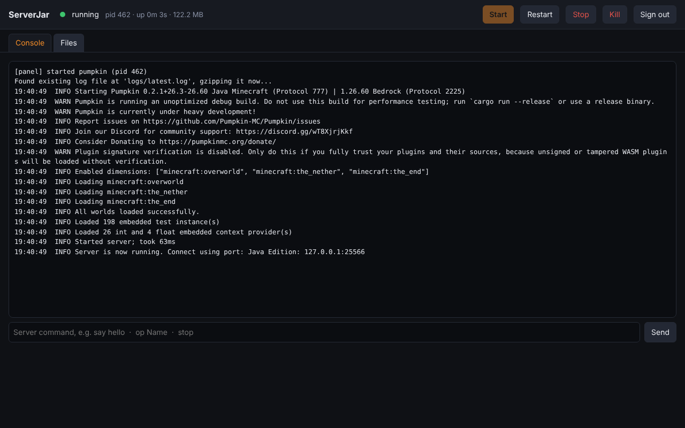

# ServerJar panel

A small web page to run the server: start, stop, restart, kill, live console with command input,
and a file browser/editor for the server folder. One Python file plus one HTML page, standard
library only, so it runs on any VPS without installing anything.



## Run

```bash
python3 panel/panel.py --server ./server          # repo layout
python3 panel/panel.py --server ~/mc              # release layout (binary + pumpkin.toml in ~/mc)
```

The first run asks for a password (or reads `PANEL_PASSWORD`). Then open http://127.0.0.1:8080.

To use it from your own computer, run it with `--tls` and bind it to all interfaces:

```bash
python3 panel/panel.py --server ~/mc --bind 0.0.0.0:8080 --tls
```

It creates a self-signed certificate on first use and serves `https://your-vps-ip:8080`. Your
browser shows a certificate warning once (self-signed certificates always do); accept it, the
connection is encrypted. Open port 8080 in the firewall. This is what `install.sh` sets up.

Without `--tls` the panel should stay on `127.0.0.1` and be reached through an SSH tunnel
(`ssh -L 8080:127.0.0.1:8080 user@vps`), because the password would otherwise travel in the clear.
Five wrong passwords lock an address out for five minutes.

Options: `--bind host:port`, `--binary pumpkin.exe` (Windows), `--autostart` (start the server
with the panel), `--set-password`.

## As a service

`panel.service` runs the panel at boot and lets it start Pumpkin (`--autostart`). It replaces
`pumpkin.service`: the panel owns the server process, so only one of the two should be enabled.

## What it does

- **Console**: live server output (last 2000 lines), a command box (`say`, `op`, `whitelist`,
  `stop`, anything Pumpkin accepts on its console), status with pid, uptime and memory.
- **Stop** sends `stop` and waits up to 30 s, then falls back to SIGTERM/SIGKILL. **Kill** skips
  the save; it asks first.
- **Files**: browse, edit text files (configs, logs, JSON, plugin configs) with Ctrl+S to save,
  create, rename, delete, upload, download. Everything is confined to the server folder; paths that
  resolve outside it are rejected. Edits to `pumpkin.toml` take effect after a restart.

## Security notes

- Password hashed with PBKDF2 (200k rounds), stored in `.panel-auth.json` in the server folder.
- Session cookie is HttpOnly and SameSite=Strict; API calls must come from the panel's own page.
- The panel has the same file access as the user it runs as, limited to the server folder. Run it
  as a dedicated user, not root.
